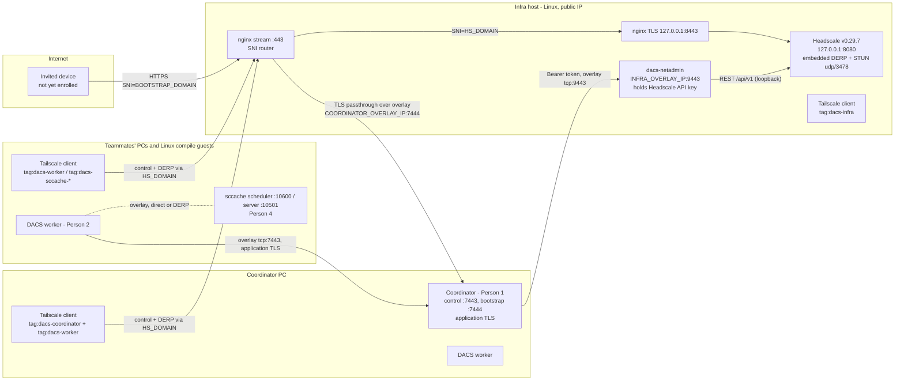

# DACS network and enrollment (Person 3)

This workspace holds the DACS private network: Headscale/Tailscale/DERP deployment
files, the enrollment adapter that runs beside Headscale, the device-side network
client and the wire contract shared with Persons 1, 2 and 4.

Contract revision: `dacs-net/2026-11-14.1` (`CONTRACT_REVISION` in
`crates/dacs-net-contract/src/lib.rs`). Admin-access disclosure revision:
`host-admin-access/1` (`ADMIN_ACCESS_DISCLOSURE_REVISION`).

## Ownership boundary

| Owner | Owns | Uses from `net/` |
|---|---|---|
| Person 3 (network) | Headscale, embedded DERP/STUN, nginx edge, enrollment adapter, network credentials, overlay reachability, network revocation, tailnet-switch detection | — |
| Person 1 (coordinator, UI, installer) | Project/device authorization, invitation UX, setup UI, installer, coordinator database (stores `auth_key_id`/`node_id`), application TLS and device authentication | `dacs-net-contract` types, the `dacs-netadmin` HTTP API, `dacs_netclient::{assess, join, leave}` |
| Person 2 (worker) | Worker execution | `LocalJoinResult` (coordinator overlay URL) |
| Person 4 (builds) | sccache pools, compile evidence | `CompilerEndpoint` list, `dacs-net compiler-check`, `peers`, `traffic`, `ping` |

Person 3 performs network operations only after Person 1's authorization and the
owner's consent. Installation, project authorization and network membership are
separate states; this code models only network membership (`MembershipState`).

This `net/` directory is a standalone Cargo workspace only until Person 1's root
workspace exists. Integration adds the three crates as members of the root
workspace and removes `net/Cargo.toml` and `net/Cargo.lock` (see the comment at
the top of `net/Cargo.toml`).

| Path | Contents |
|---|---|
| `crates/dacs-net-contract` | Wire types, disclosures, `is_overlay_ip` |
| `crates/dacs-netadmin` | `dacs-netadmin` service (infra host only): HTTP operation API over the overlay, plus `serve`, `check`, `issue`, `gen-token`, `hash-token` |
| `crates/dacs-netclient` | Library and `dacs-net` CLI wrapping the local `tailscale` CLI |
| `deploy/headscale/config.yaml` | Headscale v0.29.7 config (loopback listen, embedded DERP region 999, MagicDNS `dacs.internal`) |
| `deploy/headscale/policy.hujson` | Default-deny ACL grants by tag |
| `deploy/nginx/dacs.conf` | Public SNI router (stream) and Headscale TLS proxy |
| `deploy/netadmin/config.example.json` | `dacs-netadmin` config (secrets referenced by path) |
| `deploy/netadmin/enrollment-request.example.json` | Coordinator `EnrollmentRequest` for `dacs-netadmin issue` |
| `deploy/netadmin/dacs-netadmin.service` | systemd unit (`check` before `serve`) |
| `deploy/infra-setup.sh` | Infra host setup script (written separately; reference only) |

## Architecture



- Headscale and nginx are the only public services. `dacs-netadmin` is not
  exposed by nginx; it listens on the infra host's overlay IP and the ACL lets only
  `tag:dacs-coordinator` reach it.
- `BOOTSTRAP_DOMAIN` is TLS passthrough: the coordinator terminates TLS on 7444
  with a certificate for `BOOTSTRAP_DOMAIN`, so the infra host never sees bootstrap
  plaintext. Any other SNI is sent to a reject upstream.
- The DERP map contains only the embedded self-hosted region (`urls: []`).
- Overlay prefixes are `100.64.0.0/10` and `fd7a:115c:a1e0::/48`; MagicDNS names are
  `<host_name>.dacs.internal` and do not override the hosts' own resolvers
  (`override_local_dns: false`).

## Enrollment sequence

```mermaid
sequenceDiagram
  autonumber
  actor Owner as Host owner
  participant UI as Person 1 setup UI (device)
  participant NC as dacs_netclient (device)
  participant C as Coordinator (Person 1)
  participant NA as dacs-netadmin (infra, overlay)
  participant HS as Headscale
  participant W as Worker (Person 2)

  Owner->>UI: Open invitation (display only, no network change)
  UI->>NC: assess(login_server) / dacs-net assess LOGIN_SERVER
  NC-->>UI: TailnetAssessment {client, already_dacs, requires_switch_consent, previous_control_url, disclosure}
  UI->>Owner: Named host + ADMIN_ACCESS_DISCLOSURE (+ TAILNET_SWITCH_DISCLOSURE if requires_switch_consent)
  Owner->>UI: Accept -> HostConsent {tailnet_switch: TailnetSwitchConsent | null}
  UI->>C: HostConsent (over bootstrap API)
  C->>C: Individual host approval -> HostApproval
  C->>NA: POST /v1/enrollments EnrollmentRequest {consent, approval, roles}
  NA->>NA: validate (device/host match, disclosure revision, roles, no infra)
  NA->>HS: create single-use, non-ephemeral, tagged pre-auth key (TTL 15 min)
  NA-->>C: EnrollmentGrant {auth_key, auth_key_id, tags, expires_at, coordinator}
  C->>C: store auth_key_id
  C-->>NC: EnrollmentGrant (to this device only, over application TLS)
  NC->>NC: join(grant, consent, opts): re-assess, check_join
  NC->>HS: tailscale login --login-server --auth-key=file:... --hostname
  NC-->>UI: LocalJoinResult {device_id, host_name, overlay_ips, coordinator, displaced_control_url}
  C->>NA: POST /v1/memberships/query {device_id, host_name, auth_key_id}
  NA->>HS: list nodes, rename node to approved host_name if needed
  NA-->>C: NetworkMembership {state: joined {node_id, online}, overlay_ips, tags}
  C->>C: store node_id
  UI->>W: LocalJoinResult
  W->>C: connect coordinator.overlay_url with application TLS + device auth

  Note over C,HS: Revocation
  C->>NA: POST /v1/revocations {device_id, auth_key_id, node_id, requested_by, reason}
  NA->>HS: expire key if unused and unexpired; delete DACS-tagged node; re-list
  NA-->>C: RevocationOutcome {key_expired, node_deleted, verified_absent, at}
```

`join` refuses (no network change) when: the consent belongs to another device or
host name; the consent's `disclosure_revision` is stale; the grant has expired; the
grant's `login_server` is not `https://`; Tailscale is not installed or its daemon
is unreachable; the host is already on the DACS control server; or another control
server is active and `consent.tailnet_switch.previous_control_url` does not match
it. `join` uses `tailscale login`, which adds a profile instead of deleting the
existing one, so the owner can `tailscale switch` back. The auth key is passed via a
private temporary file, never on the command line, and the file is removed after
the `login` call. `join` then waits up to 30 s for `Running` with overlay IPs on the
DACS control URL.

A revoked node cannot rejoin: its key was single-use and is already consumed.
Rejoining needs a new approved grant. Enrolling a `host_name` that is still
registered returns 409; revoke it first.

## Contracts per owner

All types are in `crates/dacs-net-contract/src/lib.rs`. Timestamps are RFC 3339.
`DeviceId` is a plain string. `HostName` is a single DNS label: 1-63 characters,
lowercase ASCII letters, digits or `-`, not starting or ending with `-`.

### Person 1: coordinator and setup UI

Device-side types (setup UI, recorded locally on the host):

- `HostConsent { device_id, accepted_host: HostName, accepted_by, accepted_at, disclosure_revision, tailnet_switch: Option<TailnetSwitchConsent> }`.
  `disclosure_revision` must equal `ADMIN_ACCESS_DISCLOSURE_REVISION`.
- `TailnetSwitchConsent { previous_control_url, previous_tailnet: Option<String>, accepted_at }`. Required when
  `TailnetAssessment.requires_switch_consent` is true; `previous_control_url` must
  match `TailnetAssessment.previous_control_url` (URL compared normalized).
- `TailnetAssessment { login_server, client: TailnetClientState, already_dacs, requires_switch_consent, previous_control_url, disclosure }`.
- `TailnetClientState` (tag `state`): `not_installed` | `daemon_unavailable { detail }` | `logged_out` |
  `logged_in { control_url, backend_state, tailnet, self_name, overlay_ips }`. `not_installed`
  and `daemon_unavailable` are network-client prerequisite blockers for the UI.
- Disclosure text: `ADMIN_ACCESS_DISCLOSURE`, `TAILNET_SWITCH_DISCLOSURE` (constants,
  also returned by `GET /v1/contract`). An unenrolled device cannot reach
  `dacs-netadmin`, so the coordinator must serve these to the setup UI over its
  bootstrap API (or link the constants).
- Library calls (`crates/dacs-netclient/src/lib.rs`): `detect()`, `assess(login_server)`,
  `join(&EnrollmentGrant, &HostConsent, &JoinOptions)` -> `LocalJoinResult`,
  `leave(login_server)` (logs out the DACS profile only; refuses when another
  control server is active). `JoinOptions { unattended, accept_dns, timeout }`.

Coordinator-side types:

- `HostApproval { device_id, approved_by, approved_at, authorization_ref }` (`authorization_ref`
  is an opaque reference to the coordinator's authorization record).
- `EnrollmentRequest { device_id, host_name, host_kind: HostKind, roles: Vec<NodeRole>, consent: HostConsent, approval: HostApproval }`.
  - `HostKind` (tag `kind`): `{"kind":"physical"}` or `{"kind":"guest","physical_host":"<DeviceId>"}`;
    a guest (VM / Linux compile environment) joins as its own node and must name a
    different physical host.
  - `NodeRole` (snake_case) -> tag: `worker` -> `tag:dacs-worker`, `coordinator` ->
    `tag:dacs-coordinator`, `compile_scheduler` -> `tag:dacs-sccache-scheduler`,
    `compile_server` -> `tag:dacs-sccache-server`, `infra` -> `tag:dacs-infra` (refused by the API).
  - Validation: device IDs of request, consent and approval match; `consent.accepted_host == host_name`;
    current disclosure revision; non-empty `accepted_by`, `approved_by`, `authorization_ref`;
    timestamps at most 5 minutes in the future; non-empty roles; no `infra`.
- `EnrollmentGrant { contract_revision, device_id, host_name, login_server, auth_key, auth_key_id, tags, expires_at, coordinator: CoordinatorEndpoints }`.
  `auth_key` is a secret serialized as a plain string for the one device it belongs
  to; deliver it only to that device and do not log it.
- `CoordinatorEndpoints { bootstrap_url, overlay_url }` (both `https://`).
- `MembershipQuery { device_id, host_name, auth_key_id: Option<u64>, node_id: Option<u64> }`.
- `NetworkMembership { device_id, host_name, state: MembershipState, overlay_ips, tags, last_seen }`.
- `MembershipState` (tag `state`): `not_enrolled` | `key_issued { auth_key_id, expires_at }` |
  `key_expired { auth_key_id }` | `joined { node_id, online }` | `revoked { node_id }`.
  `revoked` is also reported when the key was used (or is gone) but no node remains.
- `RevocationRequest { device_id, auth_key_id: Option<u64>, node_id: Option<u64>, requested_by, reason }`;
  at least one of `auth_key_id`/`node_id` and a non-empty `requested_by` are required.
- `RevocationOutcome { device_id, key_expired, node_deleted: Option<u64>, verified_absent, at }`.
- `OverlayNode { node_id, name, overlay_ips, tags, online, last_seen }`.
- `ApiError { code, message }` (error body).

Headscale is the only network state store. The coordinator keeps `auth_key_id`
(from the grant) and `node_id` (from `joined`) in its own database for status and
revocation.

### HTTP API (`crates/dacs-netadmin/src/http.rs`)

Base URL: `https://INFRA_OVERLAY_IP:9443` (overlay only). Every route except
`/v1/health` requires `Authorization: Bearer <operation token>`; the token check runs
before body parsing.

| Method | Path | Body | Response (200) | Error statuses |
|---|---|---|---|---|
| GET | `/v1/health` | — | `{ok, contract_revision, headscale_pinned, headscale_error}` | 503 when Headscale is unhealthy (same body, `ok: false`) |
| GET | `/v1/contract` | — | `{contract_revision, admin_disclosure_revision, admin_disclosure, tailnet_switch_disclosure, login_server, coordinator, key_ttl_minutes}` | 401 |
| POST | `/v1/enrollments` | `EnrollmentRequest` | `EnrollmentGrant` | 400, 401, 403, 409, 502 |
| POST | `/v1/memberships/query` | `MembershipQuery` | `NetworkMembership` | 401, 403, 409, 502 |
| POST | `/v1/revocations` | `RevocationRequest` | `RevocationOutcome` | 400, 401, 403, 409, 502 |
| GET | `/v1/nodes` | — | `Vec<OverlayNode>` (DACS-tagged nodes only, by `node_id`) | 401, 502 |
| GET | `/v1/compiler-endpoints` | — | `Vec<CompilerEndpoint>` | 401, 502 |

Error codes (`ApiError.code`):

| Status | `code` | Cause |
|---|---|---|
| 400 | `bad_request` | `EnrollmentRequest` validation failed; revocation without `auth_key_id`/`node_id` or `requested_by` |
| 401 | `unauthorized` | Missing or invalid operation token |
| 403 | `forbidden` | Enrollment requests the `infra` role; membership/revocation targets a node or key that is not exclusively DACS-tagged (non-infra) |
| 409 | `conflict` | `host_name` already registered in Headscale; `node_id` and `auth_key_id` both given but not the same node (revocation changes nothing in that case) |
| 502 | `headscale_unavailable` | Headscale request failed or returned an unusable key |

A body that does not deserialize (malformed JSON, invalid `HostName`, unknown
enum value, missing `content-type: application/json`) returns the extractor's
status (400/415/422) with an `ApiError` body whose `code` is `bad_request`.

### Person 2: worker

The worker receives only `LocalJoinResult { device_id, host_name, overlay_ips, coordinator: CoordinatorEndpoints, displaced_control_url }`
from the setup flow, and connects to `coordinator.overlay_url` with application TLS
and device authentication. It never receives the Headscale API key or an operation
token; the single-use auth key is consumed by `join` and is not part of
`LocalJoinResult`.

### Person 4: builds

- `CompilerEndpoint { host_name, role: CompilerRole, overlay_ip, port }`, `role` is
  `scheduler` | `server`; `socket_addr()` gives `overlay_ip:port`. Obtained from
  `GET /v1/compiler-endpoints` (via the coordinator). Only nodes tagged
  `tag:dacs-sccache-scheduler` / `tag:dacs-sccache-server` with an overlay IPv4
  address are listed; ports come from `compiler_ports` in the netadmin config
  (default scheduler 10600, server 10501). Non-overlay addresses are never published.
- Enroll compile nodes with roles `compile_scheduler` / `compile_server`; a Linux
  compile guest uses `HostKind::Guest` and joins as its own node.
- Evidence commands (`dacs-net`, JSON on stdout):
  - `dacs-net compiler-check --endpoints <file> [--timeout-ms 3000]`: for each endpoint,
    TCP probe (`TcpProbe { target, overlay_private, reachable, connect_ms, error }`)
    and an active `tailscale ping` path; `ok` requires overlay-private and reachable.
    Exit 2 if any endpoint fails or the list is empty.
  - `dacs-net peers > before.json`, run the build, `dacs-net peers > after.json`, then
    `dacs-net traffic --before before.json --after after.json`: per peer
    `{host_name, path_after, rx_bytes, tx_bytes}` deltas. `PeerSnapshot { host_name, overlay_ips, online, path, rx_bytes, tx_bytes }`.
    Passive paths can show only the home DERP region for idle peers.
  - `dacs-net ping <peer> [--count 5]`: `PathProbe { peer, path, rtt_ms, measured_at }`; exit 2 if unreachable.
  - `dacs-net probe <addr:port>... [--timeout-ms 3000]`: TCP reachability; exit 2 if any fails.
- `PeerPath` (tag `path`): `direct { endpoint }` | `derp { region }` | `peer_relay { relay }` |
  `unreachable { detail }`. `direct` vs `derp` is the direct/relayed distinction to report.

### `dacs-net` CLI summary (`crates/dacs-netclient/src/main.rs`)

| Command | Purpose |
|---|---|
| `status` | Local `TailnetClientState` |
| `assess <LOGIN_SERVER>` | `TailnetAssessment`; no changes |
| `join --grant <file> --consent <file> [--unattended] [--no-dns]` | Join with an `EnrollmentGrant` and `HostConsent`; prints `LocalJoinResult` |
| `leave <LOGIN_SERVER>` | Log out of the DACS profile only |
| `peers` | `Vec<PeerSnapshot>` |
| `ping <peer> [--count N]` | `PathProbe` |
| `probe <ADDR:PORT>... [--timeout-ms N]` | `Vec<TcpProbe>` |
| `compiler-check --endpoints <file> [--timeout-ms N]` | Compiler endpoint reachability and path |
| `traffic --before <file> --after <file>` | Per-peer byte deltas and path |

Exit codes: 0 success, 2 the command ran but a check failed (`ping`, `probe`,
`compiler-check`), 1 error. The CLI is found via `DACS_TAILSCALE_BIN`, then `PATH`,
then platform default install paths. No command prints the auth key.

## Coordinator-first bootstrap

The netadmin API is overlay-only and reachable only from `tag:dacs-coordinator`, and
the public bootstrap passthrough needs the coordinator's overlay IP. The coordinator
is therefore enrolled first, locally on the infra host:

1. Infra host: run `net/deploy/infra-setup.sh` (Headscale, nginx, infra Tailscale node
   as `tag:dacs-infra`, `dacs-netadmin`). Generate the coordinator's operation token
   with `dacs-netadmin gen-token` (token on stdout, its SHA-256 hash on stderr); put
   the hash in the file at `operation_token_hashes_path` (mode 600). The token goes
   to Person 1 privately.
2. Write the coordinator's `EnrollmentRequest` (template:
   `deploy/netadmin/enrollment-request.example.json`, roles `coordinator` and
   `worker`, `host_name` `coordinator`, with real consent and approval values).
   `host_name` must match the label in `coordinator.overlay_url`
   (`https://coordinator.dacs.internal:7443` in the example config).
3. Infra host: `dacs-netadmin issue --config /etc/dacs-netadmin/config.json --request <file> --out <grant.json>`.
   Same validation as the API; the grant file (contains the single-use key) is
   created mode 600 and must not already exist. Only non-secret fields are printed.
4. Move the grant file to the coordinator PC privately, within the key TTL (15 min).
5. Coordinator PC: `dacs-net join --grant <grant.json> --consent <consent.json>`, then
   delete the grant file.
6. Set `COORDINATOR_OVERLAY_IP` to the coordinator's overlay IPv4 and rerun
   `net/deploy/infra-setup.sh` so nginx forwards `BOOTSTRAP_DOMAIN` to
   `COORDINATOR_OVERLAY_IP:7444`.
7. The coordinator now calls the API over the overlay (for example
   `POST /v1/memberships/query` for itself) and enrolls all other devices through
   `POST /v1/enrollments`.

Other `dacs-netadmin` subcommands: `serve --config <path>`, `check --config <path>`
(config, secret file permissions, Headscale connectivity), `hash-token` (hash of a
token read from stdin). `--config` defaults to `/etc/dacs-netadmin/config.json`.

## Ports and ACL (`deploy/headscale/policy.hujson`)

Default deny; only these grants exist. Tags are owned by `group:dacs-admins`.

| Port | Service | Sources | Destination | Confirm with |
|---|---|---|---|---|
| tcp/7443 | Coordinator control API (application TLS + device auth) | `tag:dacs-worker`, `tag:dacs-sccache-scheduler`, `tag:dacs-sccache-server` | `tag:dacs-coordinator` | Person 1 |
| tcp/7444 | Coordinator bootstrap API (via infra passthrough only) | `tag:dacs-infra` | `tag:dacs-coordinator` | Person 1 |
| tcp/9443 | `dacs-netadmin` operation API | `tag:dacs-coordinator` | `tag:dacs-infra` | — |
| tcp/10600 | sccache-dist scheduler | `tag:dacs-worker`, `tag:dacs-coordinator`, `tag:dacs-sccache-server` | `tag:dacs-sccache-scheduler` | Person 4 |
| tcp/10501 | sccache-dist build server | `tag:dacs-sccache-scheduler`, `tag:dacs-worker`, `tag:dacs-coordinator` | `tag:dacs-sccache-server` | Person 4 |

Public ports on the infra host: tcp/443 (nginx SNI router), tcp/80 (ACME HTTP-01,
`/generate_204`, redirect to HTTPS), udp/3478 (STUN). Headscale (8080), its metrics
(9090) and gRPC (50443) listen on loopback only.

Ports 7443/7444 are proposals pending Person 1's confirmation; 10600/10501 are the
sccache-dist defaults pending Person 4's confirmation. Changing a port means editing
`policy.hujson` (and `compiler_ports` in the netadmin config, or the nginx upstream
for 7444).

## Security model and limits

- Headscale administrative credentials (the API key file) exist only on the infra
  host, readable only by the `dacs-netadmin` service account; `check` refuses secret
  files that are group/world accessible. They never go to agent PCs, the
  coordinator, invitation links or worker configuration.
- The coordinator holds an operation token, stored on the infra host only as a
  SHA-256 hash and compared in constant time. Its scope is limited to DACS-tagged,
  non-infra nodes and keys: it cannot create `tag:dacs-infra` keys or touch personal
  nodes, users or the policy.
- Each grant is a single-use, non-ephemeral, tags-only pre-auth key with a 15-minute
  TTL (`key_ttl_minutes`, 1-1440). A reusable or ephemeral key returned by Headscale
  is expired and refused. Nodes do not expire on a timer; DACS revokes explicitly.
- Enrollment and revocation are recorded in an append-only JSON-lines audit log
  without secrets.
- The API requires TLS unless it listens on loopback with `allow_plaintext_loopback`;
  `headscale_url` must be `https://` or loopback `http://`; `login_server` and the
  coordinator URLs must be `https://`.
- Overlay membership is not identity. Application-layer TLS and device
  authentication on coordinator traffic remain Person 1's responsibility.
- Accepted risk: a compromised coordinator operation token can enroll new
  worker-, coordinator- or compile-tagged nodes, which then get the access the ACL
  grants those tags. It cannot reach infra or non-DACS nodes. Revoke the token by
  removing its hash and restarting `dacs-netadmin`.
- Relayed traffic uses the single self-hosted DERP region on the infra host. No
  relay throughput or build speedup is promised; report the observed path.
- Tailscale runs one network at a time. Joining DACS displaces an existing login,
  which `join` never does without `TailnetSwitchConsent`.
- Linux: `tailscale login` needs root, or run `sudo tailscale set --operator=$USER`
  once so the owner's account can run it.
- Windows: `dacs-net join --unattended` (`JoinOptions.unattended`) keeps the tunnel up
  after the GUI user logs out.

## Build and test

From `net/`:

```sh
cargo test --workspace
cargo clippy --workspace --all-targets
```

Tests use an in-memory Headscale fake and Tailscale CLI output fixtures; they do not
contact a real Headscale server or modify the local Tailscale client.

## Verification status (2026-11-14)

| Check | Result | Evidence |
|---|---|---|
| Unit tests (`cargo test --workspace`, 33 tests) and `cargo clippy --workspace --all-targets` | Passed | Run from `net/` on Windows, Rust 1.100 |
| `dacs-netadmin` against real Headscale v0.29.7 + Tailscale 1.104.7 client (isolated WSL): enroll, single-use reuse refused, join, rename, membership, compiler endpoints, 401/400/409, revoke, no reconnect, revoke-before-use | Passed | `evidence/local-headscale-integration.md` |
| `dacs-net status` / `assess` against the real Windows Tailscale 1.104.7 client (logged out) | Passed: `logged_out`, no switch consent needed | Local run |
| `deploy/infra-setup.sh` | Syntax and ShellCheck only; not executed. Its policy-before-user ordering is confirmed: in the WSL run Headscale started with the unchanged policy before `dacs-admin` existed | — |
| Public Linux server, DNS, Let's Encrypt TLS, nginx SNI router, public DERP/STUN | Not run: no server, domain or DNS access was available | — |
| netadmin over TLS on the infra overlay IP | Not run | — |
| `dacs-net join` end to end, tailnet-switch consent on a host with an existing login | Not run (decision logic unit-tested only) | — |
| Direct vs DERP paths between fleet PCs, compiler reachability (10600/10501), Linux compile guest as its own node, revocation on real hosts | Not run: needs the fleet and the public infra host | — |
| Task-board Leptos frontend (four-agent demo) | Not started: must run through completed DACS against Person 2's API | — |
